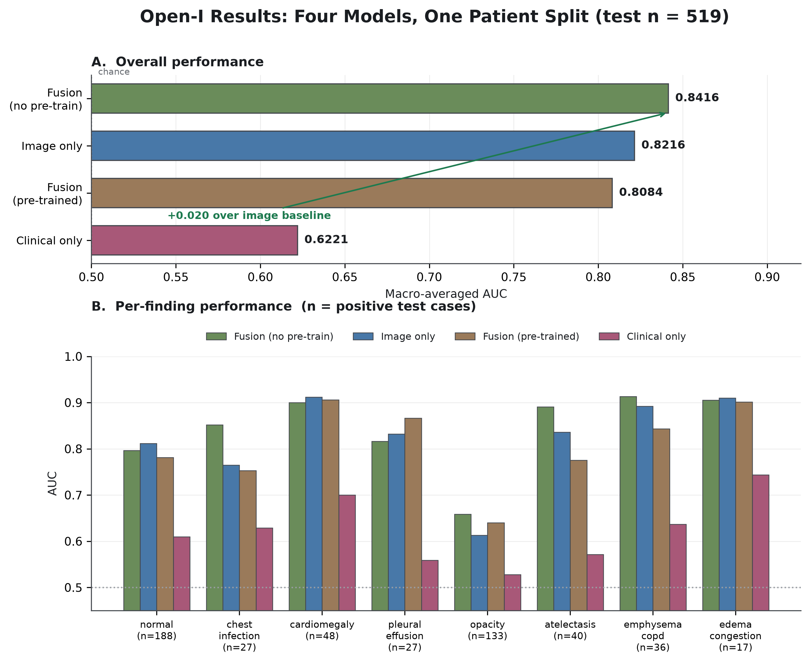
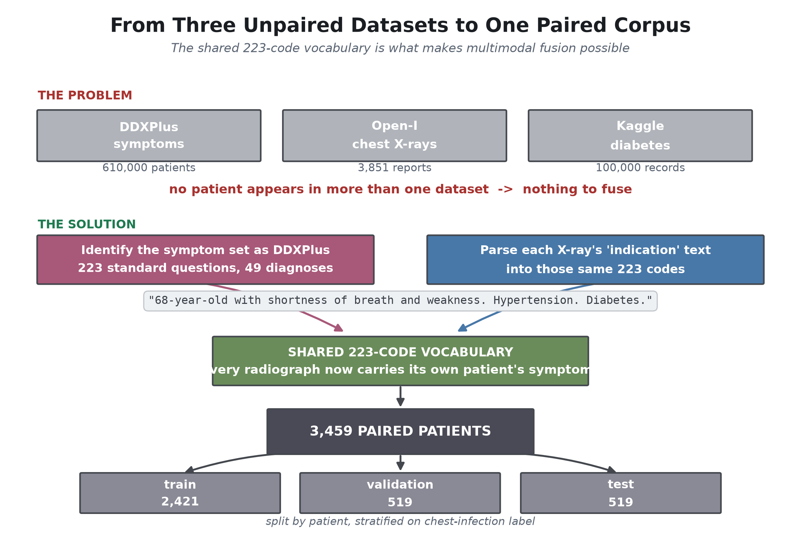
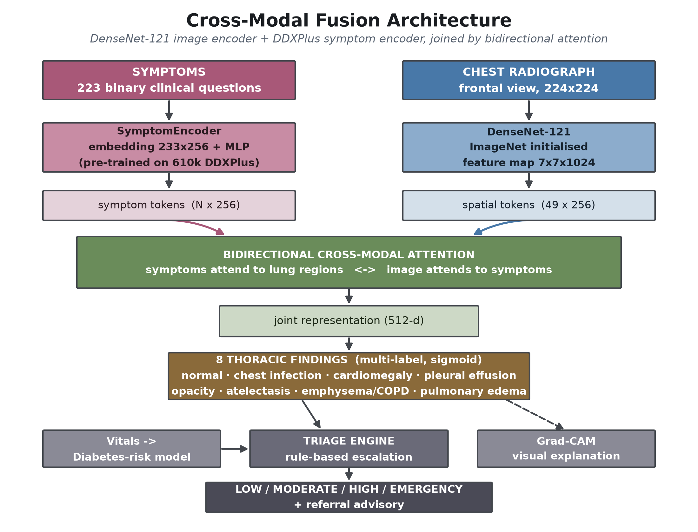
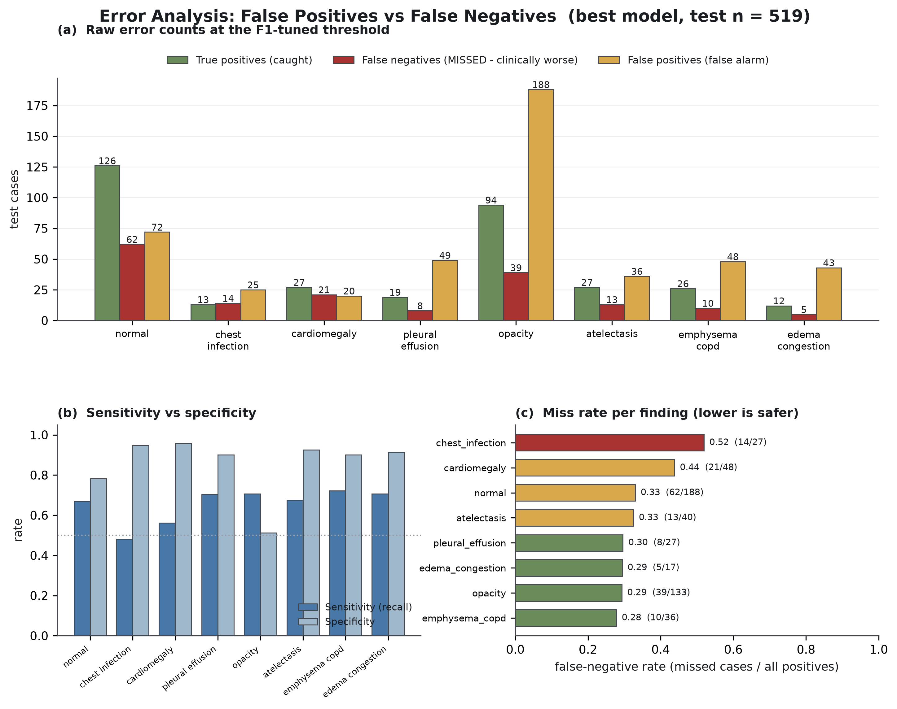
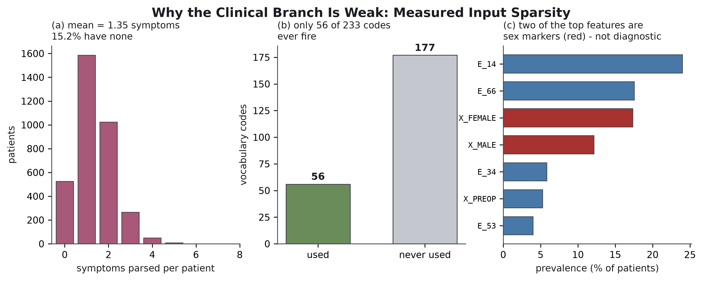

# AI-Based Medical Decision-Support System

**Cross-modal fusion of clinical symptoms and chest radiographs through a shared diagnostic vocabulary**

Major Project-I (18B19CI791) · **Group RG24** · Jaypee University of Information Technology, Dept. of CSE & IT
Supervisor: **Dr. Hari Singh**

A multimodal deep-learning system that combines **patient-reported symptoms** with a **chest
radiograph** to predict eight thoracic findings simultaneously, explain the image decision with
Grad-CAM, and produce a rule-based triage recommendation.

> ⚠️ **Research prototype for an academic project.** This is clinical decision *support*, not a
> diagnosis. It is not clinically validated and must not be used without qualified medical review.

---

## Headline results

Four models, one identical patient split (2,421 train / 519 val / **519 test**):

| Model | Macro AUC | Best on |
|---|---|---|
| 🏆 **Fusion** (no DDXPlus pre-training) | **0.8416** | 4 of 8 findings |
| Image only (DenseNet-121) | 0.8216 | 3 of 8 |
| Fusion (with pre-training) | 0.8084 | 1 of 8 |
| Clinical only (symptoms) | 0.6221 | — |



**The central hypothesis holds:** fusing symptoms with the radiograph beats the image-only
baseline by **+0.020 macro AUC**, with the largest gains on chest infection (+0.087) and
atelectasis (+0.055).

Two results are reported with equal prominence because they qualify that headline:

1. **DDXPlus pre-training made things worse** (0.808, *below* the image baseline). The encoder was
   fitted to dense DDXPlus questionnaires, but Open-I yields only **1.35 symptoms per patient**.
   The shared *vocabulary* is still what makes a paired dataset exist at all — it is specifically
   the *weight transfer* that failed. Only the ablation revealed this.
2. **The +0.020 margin is from a single split** with no significance test. Read it as a consistent
   trend across 4 of 8 findings, not an established effect size.

📄 **Full write-up with all diagrams: [reports/PROJECT_REPORT.md](reports/PROJECT_REPORT.md)**

---

## The problem this project had to solve first

The three datasets in the proposal contain **no overlapping patients**:

| Dataset | Size | Patient overlap |
|---|---|---|
| DDXPlus symptoms | 610,000 patients | none |
| Open-I chest X-rays | 3,851 reports | none |
| Kaggle diabetes | 100,000 records | none |

So "multimodal fusion" had nothing to fuse — symptoms could not correlate with radiographic
findings because nothing linked a patient's symptoms to their radiograph. **This was a
data-pairing problem, not a modelling one.**

### The fix: one shared clinical vocabulary



Every Open-I report carries an **indication** field — the referring physician's reason for
ordering the scan, in free text:

```
"68-year-old with shortness of breath and weakness. Hypertension. Diabetes."
```

We parse that text into the **same 223 DDXPlus question codes** used by the symptom model. Every
radiograph now carries a symptom vector belonging to *the same patient*, producing **3,459
genuinely paired patients**. This is the project's principal technical contribution.

**Evidence the link is real** — lift = P(finding | symptom) / P(finding):

| Symptom in indication | X-ray finding | Patients | Base rate | Given symptom | Lift |
|---|---|---|---|---|---|
| Hypoxia / low O₂ saturation | chest infection | 29 | 5.3% | 24.1% | **4.6×** |
| Surgery within last month | pleural effusion | 47 | 4.6% | 17.0% | **3.7×** |
| Previous pneumonia | chest infection | 73 | 5.3% | 16.4% | **3.1×** |

---

## Architecture



The symptom branch embeds a 233-dim binary vector into 256-d tokens; DenseNet-121 produces a
7×7×1024 map projected to 49 spatial tokens. **Bidirectional cross-modal attention** lets each
symptom attend to lung regions and the image summary attend to symptoms. Eight independent
sigmoid outputs handle the multi-label case (findings co-occur).

The **triage engine** encodes the comorbidity interaction that motivated the project: a suspected
chest infection in a patient with elevated diabetes risk is escalated above either finding alone,
because impaired immune response worsens pneumonia outcomes.

---

## ⚕️ Error analysis — the most important practical finding

AUC is threshold-free and hides how the system behaves in use.



**At the default F1-tuned threshold, the system misses 52% of chest infections (14 of 27)** — the
most dangerous error it can make, since chest infection is exactly what the triage engine
escalates in diabetic patients. In decision support a false negative costs far more than a false
alarm.

**But this is a threshold artefact, not a capability limit:**

| Threshold | Missed | Sensitivity | False alarms |
|---|---|---|---|
| F1-tuned (default) | **14** | 0.48 | 25 |
| **0.15 (screening)** | **2** | **0.93** | 220 |

The model ranks positive cases correctly (AUC 0.852 for this finding); the default threshold
discards that ranking. Aggregate **FP : FN ≈ 2.8 : 1** — the system already over-calls, yet still
misses half the infections, which means the thresholds are simply mis-chosen for clinical use.

➡️ **Top recommendation: use per-finding screening thresholds, not F1-tuned ones.** No retraining
required. Quantified for every finding in [`reports/threshold_tradeoff.json`](reports/threshold_tradeoff.json).

---

## Why the clinical branch is weak



| Measure | Value |
|---|---|
| Vocabulary columns | 233 |
| Columns that ever fire | **56** (177 never) |
| Mean symptoms per patient | **1.35** |
| Patients with an empty symptom vector | **15.2%** |
| Irrecoverably de-identified | **8.3%** |

Open-I was de-identified before publication, replacing clinical terms with `XXXX`
(`"XXXX-year-old XXXX with XXXX."`) — 8.3% of patients are unrecoverable by any parser. Worse,
**two of the four most frequent features are patient sex**, which says almost nothing about
thoracic findings. The branch's most *available* signal is its least *diagnostic*.

This single measurement explains both the modest fusion margin and the pre-training failure.

---

## Repository layout

```
src/medsupport/
  config.py                   paths, thoracic labels, indication→evidence vocabulary
  data/prepare_ddxplus.py     DDXPlus csv → parquet splits + question metadata
  data/prepare_diabetes.py    diabetes csv → scaled parquet splits
  data/prepare_openi.py       Open-I reports → labels + evidence vectors + frontal images
  models/clinical.py          ClinicalMLP, SymptomEncoder, SymptomEncoderClassifier
  models/imaging.py           DenseNet-121 feature extractor (ImageNet init)
  models/fusion.py            CrossModalFusionNet — bidirectional cross-attention
  explain/gradcam.py          Grad-CAM over the DenseNet feature map
  triage.py                   transparent rule-based triage engine
  train/tabular.py            trainer for diabetes / ddxplus / symptom_encoder
  train/imaging.py            trainer for image / clinical / fusion on Open-I
scripts/
  download_data.py            fetch all datasets into data/raw
  run_all_experiments.py      train all four arms + comparison, end to end
  make_report_figures.py      regenerate every diagram in the report
  analyze_correlation.py      symptom ↔ X-ray lift analysis
  compare_openi.py            comparison table + ROC curves
app/app.py                    Streamlit demo
reports/                      metrics, tables, 23 figures, full report (committed)
models/                       trained weights (not committed — see .gitignore)
```

## Reproduce

```bash
pip install -r requirements.txt
python scripts/download_data.py            # ~2.5 GB, mostly X-ray images
export PYTHONPATH=src                      # Windows: set PYTHONPATH=src

# build datasets
python -m medsupport.data.prepare_diabetes
python -m medsupport.data.prepare_ddxplus
python -m medsupport.data.prepare_openi

# pre-train the clinical models
python -m medsupport.train.tabular diabetes
python -m medsupport.train.tabular ddxplus --bs 2048 --lr 2e-3 --hidden 512,256
python -m medsupport.train.tabular symptom_encoder --bs 2048 --lr 2e-3 --hidden 256

# train all four Open-I arms + comparison in one go
python scripts/run_all_experiments.py --skip-prepare

# regenerate every figure in the report
python scripts/make_report_figures.py

# demo
streamlit run app/app.py
```

> **Windows note:** training defaults to `--workers 0`. Windows *spawns* DataLoader workers, so
> each re-imports PyTorch and reserves CUDA memory; with 4 workers a 16 GB machine exhausts its
> commit limit and dies with `WinError 1455` before the first epoch. The GPU is the bottleneck
> anyway (~27 s/epoch), so throughput is unaffected.

## Results and artefacts

| File | Contents |
|---|---|
| [`reports/PROJECT_REPORT.md`](reports/PROJECT_REPORT.md) | **Full report** — method, results, error analysis, limitations |
| [`reports/RESULTS.md`](reports/RESULTS.md) | All metrics tables |
| [`reports/error_analysis.json`](reports/error_analysis.json) | Per-finding TP/FP/FN/TN and derived rates |
| [`reports/threshold_tradeoff.json`](reports/threshold_tradeoff.json) | Screening-threshold analysis |
| [`reports/clinical_signal_analysis.md`](reports/clinical_signal_analysis.md) | Sparsity investigation |
| [`reports/symptom_xray_correlation.md`](reports/symptom_xray_correlation.md) | Full lift table |
| `reports/figures/` | All 23 figures |

## Limitations

- **Single split, no significance test.** The +0.020 margin needs multiple seeds and a DeLong test.
- **Small test set** (519 patients). Rare findings are noisy — pulmonary edema has 17 cases,
  chest infection 27.
- **DDXPlus is synthetic.** The 99.34% symptom-model accuracy reflects a knowledge-base-generated
  dataset; it demonstrates pipeline correctness, not clinical accuracy.
- **Indication text is a proxy**, not a symptom history — and it is written by a clinician who
  already suspected a finding.
- **Not clinically validated.**

## Future work

1. **Adopt per-finding screening thresholds** — highest impact, no retraining needed.
2. **Evaluate on MIMIC-CXR** — full reports with structured clinical data, less aggressive
   de-identification.
3. **Establish statistical confidence** — multiple seeds, mean ± std, DeLong test.
4. **Revise the pre-training strategy** — fine-tune on Open-I's sparsity, or pre-train on
   artificially sparsified DDXPlus so source and target distributions match.
5. **Restrict fusion to cardiac findings**, where the clinical branch carries real signal
   (cardiomegaly 0.700, pulmonary edema 0.743) versus parenchymal ones (opacity 0.528).

## Datasets and credits

| # | Dataset | Source | Used for |
|---|---|---|---|
| 1 | DDXPlus (Kaggle mirror) | [kaggle](https://www.kaggle.com/datasets/muherezaalouzious/disease-symptom-prediction-dataset) · [question texts](https://huggingface.co/datasets/aai530-group6/ddxplus) | symptom → diagnosis model; SymptomEncoder pre-training |
| 2 | Chest X-rays (Indiana University, Open-I) | [kaggle](https://www.kaggle.com/datasets/raddar/chest-xrays-indiana-university) · images via official NLM Open-I API | image branch, fusion, Grad-CAM |
| 3 | Diabetes Prediction Dataset | [kaggle](https://www.kaggle.com/datasets/iammustafatz/diabetes-prediction-dataset) | diabetes-risk model |
| 4 | Disease Symptom Description | [kaggle](https://www.kaggle.com/datasets/itachi9604/disease-symptom-description-dataset) | precaution / advisory text in the app |

**Open-I:** Demner-Fushman et al., *Preparing a collection of radiology examinations for
distribution and retrieval*, JAMIA 2016.
**DDXPlus:** Fansi Tchango et al., *DDXPlus: A New Dataset for Automatic Medical Diagnosis*,
NeurIPS Datasets & Benchmarks 2022.
