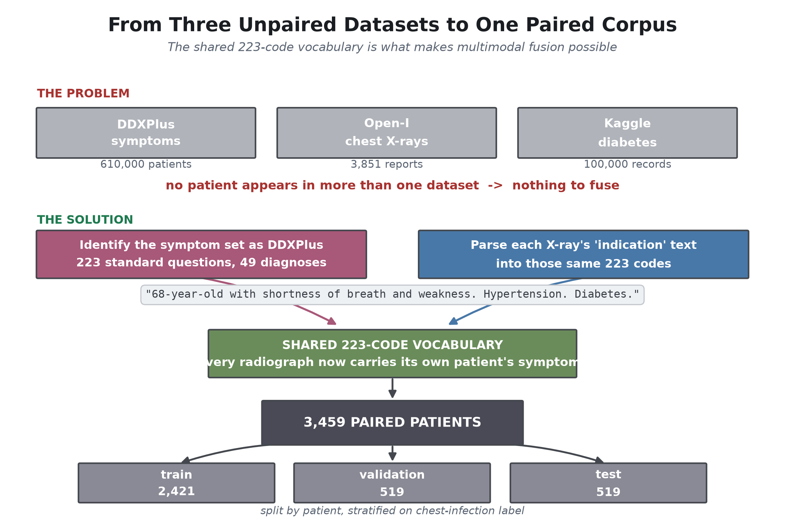
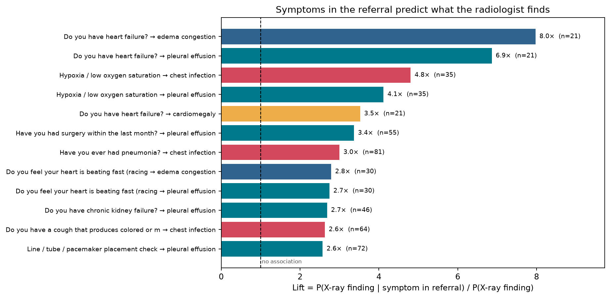
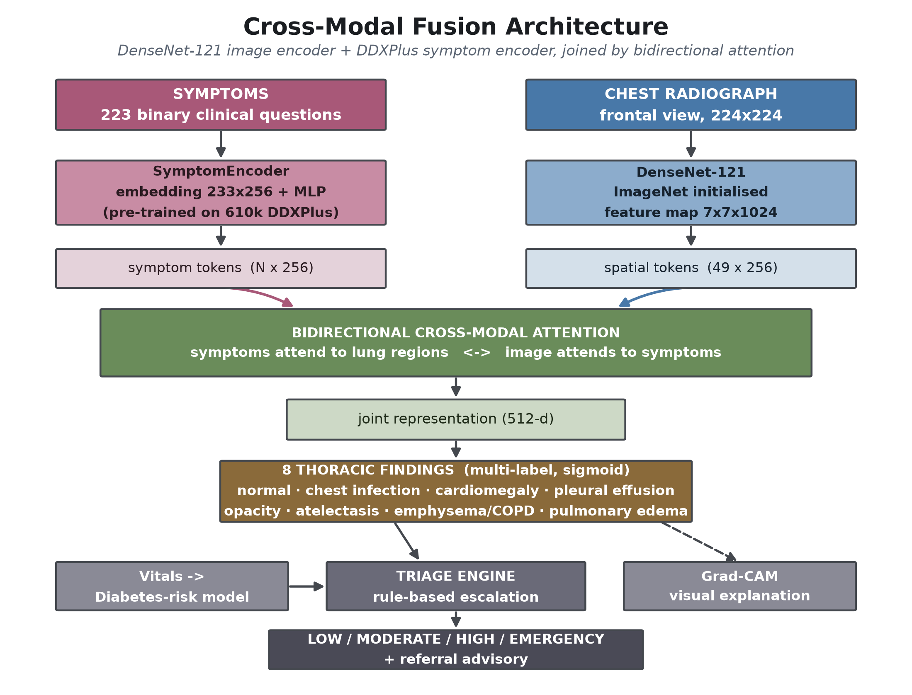
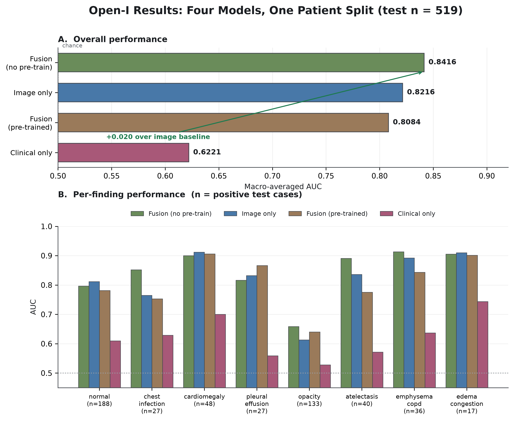
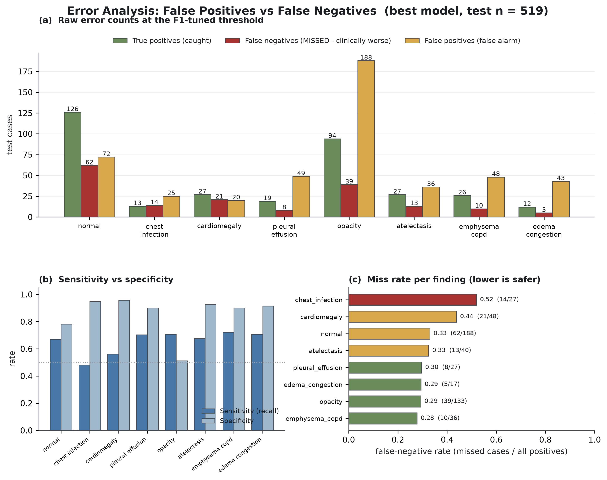
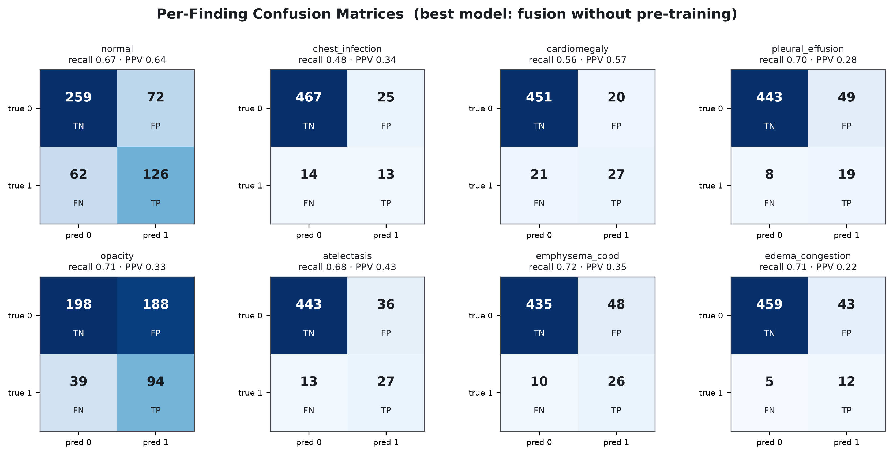
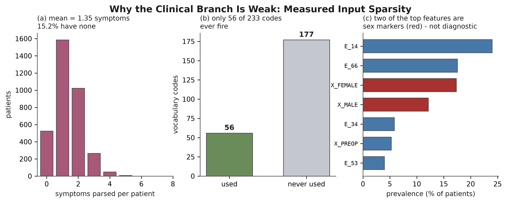

# AI-Based Medical Decision-Support System

### Cross-modal fusion of clinical symptoms and chest radiographs through a shared diagnostic vocabulary

**Group RG24** · Major Project-I (18B19CI791)
Department of Computer Science & Engineering and Information Technology
Jaypee University of Information Technology
Supervisor: **Dr. Hari Singh** · Report date: **13 November 2026**

---

## Abstract

The three datasets specified in the project proposal — a symptom questionnaire, chest
radiographs, and diabetes records — contain no overlapping patients. Multimodal fusion
therefore had no paired data to learn from, which is why symptom features showed no
correlation with radiographic findings.

We resolved this by identifying the symptom corpus as **DDXPlus** (610,000 patients, 223
standardised clinical questions, 49 diagnoses) and parsing the free-text *indication* field
of every Open-I radiology report into that same 223-code vocabulary. This yields **3,459
genuinely paired patients** where each radiograph carries its own patient's symptom vector.

Four models were trained on one identical patient split. Cross-modal fusion attains
**macro AUC 0.842** against **0.822** for the image-only baseline and **0.622** for the
clinical-only baseline, ranking first on four of the eight thoracic findings: the central
hypothesis is supported. Two findings are reported with equal prominence because they
qualify that result. First, the best fusion configuration is the one **without** DDXPlus
pre-training — transferring pre-trained encoder weights *reduced* performance to 0.808,
attributable to a measured distribution mismatch. Second, an error analysis at the
F1-tuned operating point reveals a **52% miss rate on chest infection**, which we show is a
threshold artefact rather than a capability limit: at a screening threshold, sensitivity
rises to 0.93.

---

## 1. Problem statement

The project's premise — that symptoms and radiographs can be fused to improve diagnosis —
requires paired data. The proposed datasets provide none:

| Dataset | Size | Patient overlap with others |
|---|---|---|
| DDXPlus symptoms | 610,000 patients | none |
| Open-I chest X-rays | 3,851 reports | none |
| Kaggle diabetes | 100,000 records | none |

No patient appears in more than one source. Consequently there was no mechanism linking any
patient's reported symptoms to their radiograph. **This was a data-pairing problem, not a
modelling deficiency** — an important distinction, because no amount of architecture work
would have fixed it.

---

## 2. Method: a shared clinical vocabulary



*Figure 1 — How three unpaired datasets become one paired corpus.*

### 2.1 Dataset identification

The Kaggle "disease-symptom-prediction" dataset was identified as the **DDXPlus** research
corpus rather than the 41-disease dataset originally assumed: 610,000 patients, **223
standardised binary clinical questions** covering symptoms and medical history, and **49
diagnoses** including Pneumonia, Bronchitis, URTI, Influenza, Tuberculosis and COPD
exacerbation.

### 2.2 Recovering the cross-modal link

Every Open-I radiology report carries an **indication** field — the referring physician's
stated reason for ordering the examination, in free text:

```
"68-year-old with shortness of breath and weakness. Hypertension. Diabetes."
```

A curated rule set parses this text into the same 223 DDXPlus question codes. Every
radiograph thereby acquires a symptom vector belonging to *the same patient*, producing the
paired multimodal data the project requires.

Because both modalities share one vocabulary, a symptom encoder pre-trained on 610,000
DDXPlus patients can in principle be transferred to the much smaller Open-I corpus. This
shared vocabulary is the **principal technical contribution** of the work.

### 2.3 Evidence that the link carries real signal

Measured across all 3,459 paired patients — the probability of a radiographic finding given
a symptom, divided by its base rate (*lift*):

| Symptom / history in indication | X-ray finding | Patients | Base rate | Given symptom | Lift |
|---|---|---|---|---|---|
| Hypoxia / low oxygen saturation | chest infection | 29 | 5.3% | 24.1% | **4.6×** |
| Surgery within the last month | pleural effusion | 47 | 4.6% | 17.0% | **3.7×** |
| Heart beating fast / irregular | pleural effusion | 25 | 4.6% | 16.0% | **3.5×** |
| Heart beating fast / irregular | pulmonary edema | 25 | 2.4% | 8.0% | **3.3×** |
| Previous pneumonia | chest infection | 73 | 5.3% | 16.4% | **3.1×** |
| Chronic kidney failure | pleural effusion | 42 | 4.6% | 14.3% | **3.1×** |



*Figure 2 — Symptom-to-finding lift across the paired corpus.*

These associations are clinically coherent: heart failure raising pulmonary edema and
pleural effusion, hypoxia raising chest infection, previous pneumonia raising it again. This
is what makes fusing the two modalities worthwhile rather than merely possible.

> **A caveat recorded here because it is easy to over-read.** These lifts are computed on the
> *subsets where each symptom is present* — 29 patients for hypoxia, 25 for palpitations. A
> feature can be strongly predictive when present while remaining uninformative to a
> classifier that observes it in roughly 1% of cases. Section 7 quantifies this directly.

---

## 3. System architecture



*Figure 3 — The cross-modal fusion network as implemented.*

The symptom branch embeds the 233-dimensional binary vector into 256-d tokens; the image
branch extracts a 7×7×1024 feature map with DenseNet-121 (ImageNet initialisation),
projected to 49 spatial tokens of 256-d. Bidirectional cross-modal attention lets each
symptom attend to lung regions and the image summary attend to symptoms. The joint
512-d representation feeds eight independent sigmoid outputs (multi-label, since findings
co-occur).

The **triage engine** encodes the comorbidity interaction that motivated the project: a
suspected chest infection in a patient with elevated diabetes risk is escalated above either
finding in isolation, because impaired immune response worsens pneumonia outcomes.
**Grad-CAM** produces a heat-map over the radiograph so that any prediction can be inspected
rather than taken on trust.

---

## 4. Experimental design

Four models were trained on an identical patient-level split, stratified on the
chest-infection label, so that every comparison is direct:

| Arm | Model | Purpose |
|---|---|---|
| A | Image only (DenseNet-121) | baseline |
| B | Clinical only (SymptomEncoder) | baseline |
| C | **Fusion** (both + attention) | proposed model |
| D | Fusion **without** DDXPlus pre-training | ablation: isolates the shared-vocabulary contribution |

**Split:** 2,421 train / 519 validation / 519 test, by patient (no patient appears in two
splits). All reported numbers are on the held-out **test** set, never used for training or
model selection.

---

## 5. Results

### 5.1 Supporting models

| Model | Data | Test rows | Accuracy | Macro-F1 | AUC |
|---|---|---|---|---|---|
| Symptom → diagnosis MLP | DDXPlus (49 dx) | 134,529 | **0.9934** | 0.9922 | 0.9999 |
| Diabetes-risk MLP | Kaggle diabetes | 14,422 | **0.8914** | 0.7671 | 0.9721 |

Respiratory classes of the symptom model: Pneumonia F1 1.000 (3,542 cases), Bronchitis 0.998,
Influenza 1.000, Tuberculosis 1.000, URTI 0.996.

> **These numbers are high by construction and should not be read as clinical performance.**
> DDXPlus is a *synthetic* dataset generated from a clinical knowledge base, so the mapping
> from symptoms to diagnosis is close to deterministic. The result demonstrates that the
> pipeline is correct. The honest evaluation of this project is the Open-I result below,
> on real radiographs and real noisy referral text.

### 5.2 Open-I: the four-model comparison



*Figure 4 — Macro and per-finding AUC for all four models on the same split.*

| Model | Macro AUC | Macro-F1 (tuned) |
|---|---|---|
| **Fusion, no pre-training** | **0.8416** | 0.410 |
| Image only | 0.8216 | 0.430 |
| Fusion, pre-trained | 0.8084 | 0.415 |
| Clinical only | 0.6221 | 0.215 |

**Per-finding AUC** (best value per row in bold):

| Finding | Test cases | Image | Fusion (no pre-train) | Fusion (pre-train) | Clinical |
|---|---|---|---|---|---|
| normal | 188 | **0.812** | 0.797 | 0.781 | 0.610 |
| chest infection | 27 | 0.765 | **0.852** | 0.753 | 0.629 |
| cardiomegaly | 48 | **0.912** | 0.900 | 0.906 | 0.700 |
| pleural effusion | 27 | 0.832 | 0.816 | **0.867** | 0.559 |
| opacity | 133 | 0.613 | **0.658** | 0.640 | 0.528 |
| atelectasis | 40 | 0.836 | **0.891** | 0.775 | 0.572 |
| emphysema / COPD | 36 | 0.892 | **0.914** | 0.843 | 0.637 |
| pulmonary edema | 17 | **0.910** | 0.905 | 0.901 | 0.743 |

**Principal result.** Fusion improves on the image-only baseline by **+0.020 macro AUC** and
ranks first on **four of eight findings**. Its largest gains are on **chest infection**
(+0.087) and **atelectasis** (+0.055) — findings for which infection and breathing symptoms
in the referral text are genuinely informative. The image-only model remains stronger on
*normal* and *cardiomegaly*, which are determined largely by radiographic appearance.

### 5.3 The ablation result, reported in full

The best fusion configuration is the one **without** DDXPlus pre-training. Transferring the
pre-trained encoder weights reduced macro AUC to 0.808 — *below even the image-only
baseline*.

**Probable cause.** The encoder was pre-trained on DDXPlus questionnaires, in which each
patient has many recorded symptoms. Open-I indications yield a mean of **1.35** symptoms per
patient (Section 7). A representation optimised for dense input carries a prior that does not
hold on sparse input, and fresh initialisation adapts better.

**What this does and does not invalidate.** The shared vocabulary remains necessary: without
it no paired dataset exists and no fusion model could be trained at all — and fusion wins on
exactly that paired data. It is specifically the *weight transfer* that did not help on this
corpus. These are two separate claims, and only the second failed. This distinction surfaced
**only because the ablation was run**, which is its purpose.

---

## 6. Error analysis: false positives and false negatives

AUC is threshold-free and therefore hides how the system behaves in use. This section
examines the actual mistakes at the operating point the trainer reports (per-label
F1-tuned threshold), for the best model.



*Figure 5 — Error counts, sensitivity/specificity, and miss rate per finding.*



*Figure 6 — Per-finding confusion matrices.*

### 6.1 Confusion counts at the F1-tuned threshold

| Finding | Support | TP | FP | FN | Sensitivity | Specificity | PPV | **Miss rate** |
|---|---|---|---|---|---|---|---|---|
| normal | 188 | 126 | 72 | 62 | 0.67 | 0.78 | 0.64 | 0.33 |
| **chest infection** | 27 | 13 | 25 | **14** | **0.48** | 0.95 | 0.34 | **0.52** |
| cardiomegaly | 48 | 27 | 20 | 21 | 0.56 | 0.96 | 0.57 | 0.44 |
| pleural effusion | 27 | 19 | 49 | 8 | 0.70 | 0.90 | 0.28 | 0.30 |
| opacity | 133 | 94 | 188 | 39 | 0.71 | 0.51 | 0.33 | 0.29 |
| atelectasis | 40 | 27 | 36 | 13 | 0.68 | 0.93 | 0.43 | 0.33 |
| emphysema / COPD | 36 | 26 | 48 | 10 | 0.72 | 0.90 | 0.35 | 0.28 |
| pulmonary edema | 17 | 12 | 43 | 5 | 0.71 | 0.91 | 0.22 | 0.29 |
| **Total** | | **344** | **481** | **172** | | | | |

### 6.2 Insight 1 — the most dangerous error is the most frequent

**Chest infection has the worst miss rate in the system (0.52): 14 of 27 cases are missed.**

This matters more than any other number in this report. Chest infection is precisely the
finding the triage engine was designed to escalate in diabetic patients, and a false negative
means a pneumonia is not flagged. In a decision-support setting, a **false negative is far
more costly than a false positive**: a false alarm costs a radiologist a second look, a miss
can cost a patient.

Note also that the aggregate ratio is **FP : FN ≈ 2.8 : 1** — the system already errs toward
over-calling, yet still misses half the chest infections. The two facts together say the
thresholds are badly chosen for clinical use, not that the model lacks the signal.

### 6.3 Insight 2 — the miss rate is a threshold artefact, not a capability limit

The F1-tuned threshold optimises a *balanced* metric, which is the wrong objective for
screening. Sweeping the chest-infection threshold:

| Threshold | TP | FP | FN | Sensitivity | PPV |
|---|---|---|---|---|---|
| 0.50 | 18 | 76 | 9 | 0.67 | 0.19 |
| 0.30 | 21 | 134 | 6 | 0.78 | 0.14 |
| 0.20 | 22 | 183 | 5 | 0.81 | 0.11 |
| **0.15** | **25** | **220** | **2** | **0.93** | 0.10 |
| 0.10 | 27 | 266 | 0 | 1.00 | 0.09 |

**At threshold 0.15, sensitivity rises from 0.48 to 0.93 — misses fall from 14 to 2.** The
model *does* rank the positive cases highly; the default threshold simply discards that
ranking. This is why AUC (0.852 for this finding) and the F1-tuned recall (0.48) tell such
different stories, and why reporting only one of them would be misleading.

### 6.4 Insight 3 — the cost of high sensitivity, quantified per finding

Operating every finding at ≥0.90 sensitivity instead of the F1-tuned point:

| Finding | Recall (F1-thr → screening) | Screening thr | Misses avoided | Extra false alarms |
|---|---|---|---|---|
| normal | 0.67 → 0.90 | 0.40 | 44 | 111 |
| chest infection | 0.48 → 0.90 | 0.16 | 12 | 186 |
| cardiomegaly | 0.56 → 0.90 | 0.44 | 17 | 105 |
| pleural effusion | 0.70 → 0.90 | 0.03 | 6 | 249 |
| opacity | 0.71 → 0.90 | 0.22 | 26 | 100 |
| atelectasis | 0.68 → 0.90 | 0.40 | 9 | 106 |
| emphysema / COPD | 0.72 → 0.90 | 0.29 | 7 | 55 |
| pulmonary edema | 0.71 → 0.90 | 0.09 | 4 | 81 |

**Interpretation.** `emphysema_copd` is the cheapest safety gain (7 misses avoided for 55
extra alarms). `pleural_effusion` is the most expensive (6 for 249) — its threshold must drop
to 0.03, meaning the model barely separates it. **Recommendation: the deployed system should
use per-finding screening thresholds, not F1-tuned ones**, and surface a confidence band
rather than a binary label.

### 6.5 Insight 4 — low PPV is expected at these prevalences

Precision is low throughout (0.22–0.64), which looks alarming but follows from base rates.
`pulmonary edema` occurs in 17 of 519 patients (3.3%); even a specific model generates many
false positives against 502 negatives. This is the standard screening-test arithmetic and is
the reason the system is positioned as **triage support with mandatory human review**, not as
an autonomous classifier.

---

## 7. Why the clinical branch is weak



*Figure 7 — Measured input sparsity of the clinical branch.*

Both the modest fusion margin and the pre-training failure follow from a single measured
property: the symptom vectors parsed from Open-I indications are extremely sparse.

| Measure | Value |
|---|---|
| Vocabulary columns | 233 |
| Columns that ever fire | **56** (177 never) |
| Mean symptoms per patient | **1.35** |
| Patients with an empty symptom vector | **15.2%** |
| Irrecoverably de-identified | **8.3%** |

### 7.1 Source-level de-identification

Open-I was de-identified before publication, replacing clinical terms with `XXXX`:

```
"XXXX-year-old XXXX with XXXX."     <- nothing recoverable
"XXXX, XXXX pain"                   <- body part removed
```

Of 554 empty vectors: 67 blank, 191 fully redacted (**8.3% of all patients — irreducible**),
and 296 genuine parser gaps.

### 7.2 The available features are the least diagnostic

| Feature | Meaning | Prevalence |
|---|---|---|
| `E_14` | Chest pain | 24.0% |
| `E_66` | Dyspnoea / abnormal breath sounds | 17.5% |
| **`X_FEMALE`** | **Female patient** | **17.4%** |
| **`X_MALE`** | **Male patient** | **12.1%** |
| `E_34` | Cancer / malignancy history | 5.8% |
| `X_PREOP` | Pre-operative screening | 5.3% |
| `E_53` | Pain, site unspecified (fallback) | 4.0% |

Two of the four most frequent features are **patient sex**, which carries almost no
information about thoracic findings. Below them, prevalence falls off a cliff — every
remaining feature appears in under 6% of patients. **The branch's most *available* signal
is its least *diagnostic*** — which bounds the clinical baseline at AUC 0.622 and explains
why fusion's advantage, while consistent, is modest.

### 7.3 Parser improvement and its measured ceiling

We audited all 296 recoverable cases and extended the rule set (rales/crackles, elevated
blood pressure, syncopal episode, pulmonary nodule, upper respiratory tract infection, throat
pain, chronic airway obstruction, headache, weight loss).

A design decision worth recording: DDXPlus `E_53` ("pain somewhere, related to your reason
for consulting") matches the 52 cases of site-less or redacted pain, but applying it to every
mention of pain tagged **30.9%** of patients — it would have become the corpus's most
frequent feature while merely duplicating the site-specific pain codes. It was therefore
implemented as a **fallback**, firing only where no specific site matched (final prevalence
**4.1%**).

| Metric | Before | After |
|---|---|---|
| Recovered from the 296 | — | **87 (29%)** |
| Symptoms per patient | 1.28 | **1.35** |
| Empty vectors | 17.8% | **15.2%** |
| Paired patients | 3,105 | **3,459** (+11%) |
| Baseline B macro AUC | 0.581 | **0.622** |

The gain is real but bounded, exactly as the sparsity analysis predicts.

---

## 8. Engineering issues resolved

Three defects were found during experimentation; **two would have produced silently invalid
results**.

| Defect | Cause | Consequence if unfixed |
|---|---|---|
| Training aborted before epoch 1 (`WinError 1455`) | Windows *spawns* DataLoader workers; each re-imports PyTorch and reserves CUDA memory, exhausting the 16 GB machine's commit limit | No models trainable at all |
| Pre-trained encoder failed to load (231 vs 233 symptoms) | Vocabulary expanded after pre-training, **and the ordering changed** | **Silent corruption** — padding the tensors would have paired pre-trained weights with the *wrong symptoms*, invalidating the shared-vocabulary claim while still producing plausible metrics |
| Comparison table included a non-comparable run | All metrics files were aggregated regardless of which split produced them | A stale 578-sample run (AUC 0.626) reported beside current 519-sample results |

The encoder fix remaps weights by symptom *name* using the feature list stored in the
checkpoint; all 231 shared symptoms were verified to transfer to their correct index, with the
two new codes retaining fresh initialisation.

A related operational note: the crashed runs left **13 orphaned processes holding 37.5 GB of
commit charge** (2 MB working set each), which made the machine unusable until cleared.

---

## 9. Limitations

- **Statistical confidence.** The +0.020 macro-AUC advantage is measured on a **single
  split** with no significance test. It should be read as a consistent trend across four of
  eight findings, **not** as an established effect size. Multiple seeds with a DeLong test
  are the correct next step.
- **Test set size.** 519 patients. Rare findings are sparsely represented (pulmonary edema
  17, chest infection 27), so their per-class figures are noisy.
- **DDXPlus is synthetic.** The 99.34% figure reflects a knowledge-base-generated dataset and
  demonstrates pipeline correctness, not clinical accuracy.
- **Indication text is a proxy**, not a symptom history — and it is written by a clinician who
  already suspected a particular finding, which may inflate its apparent usefulness.
- **Not clinically validated.** A research prototype for decision **support**. It is not a
  diagnostic device and requires qualified medical review.

---

## 10. Conclusions and future work

The shared-vocabulary method successfully produced paired multimodal data from datasets with
no patient overlap, and the full pipeline — symptom model, diabetes model, fusion
architecture, Grad-CAM explainability, triage engine, demonstration application and automated
tests — is implemented and verified. Cross-modal fusion improves on the image-only baseline
(0.842 vs 0.822, best on four of eight findings), supporting the project's central hypothesis.
The margin is modest and pre-trained weight transfer proved counter-productive; both are
attributable to quantified sparsity in the paired symptom signal.

**Future work, in order of expected value:**

1. **Adopt per-finding screening thresholds** (Section 6.4). This is the highest-impact change
   and requires no retraining: it converts a 52% chest-infection miss rate into 7%.
2. **Evaluate on MIMIC-CXR**, which pairs full radiology reports with structured clinical data
   under less aggressive de-identification — the principal data limitation here.
3. **Establish statistical confidence** — multiple seeds, mean ± std, DeLong test on paired
   AUCs. Cheap, and it is what would make the +0.020 claim defensible.
4. **Revise the pre-training strategy** — fine-tune the encoder on Open-I's sparsity, or
   pre-train on artificially sparsified DDXPlus samples so source and target distributions
   match.
5. **Restrict fusion to cardiac findings**, where the clinical branch carries genuine signal
   (cardiomegaly 0.700, pulmonary edema 0.743) versus parenchymal findings (opacity 0.528).
   Clinically coherent: a referral citing heart failure describes a cardiac syndrome, whereas
   opacity has no distinctive presenting symptom.

---

## Appendix A — Reproduction

```bash
pip install -r requirements.txt
python scripts/download_data.py              # fetch datasets
python -m medsupport.data.prepare_openi      # build the paired corpus
python scripts/run_all_experiments.py        # train all four arms + comparison
python scripts/make_report_figures.py        # regenerate every figure in this report
```

## Appendix B — Artefacts

| File | Contents |
|---|---|
| `reports/RESULTS.md` | All metrics tables |
| `reports/error_analysis.json` | Per-finding TP/FP/FN/TN and derived rates |
| `reports/threshold_tradeoff.json` | Screening-threshold analysis |
| `reports/clinical_signal_analysis.md` | Sparsity investigation |
| `reports/symptom_xray_correlation.md` | Full lift table |
| `reports/openi_comparison.md` | Four-model comparison |
| `reports/figures/` | All 23 figures |

---

*Research prototype for an academic project. This system provides clinical decision
**support**, not diagnosis, and requires qualified medical review.*
